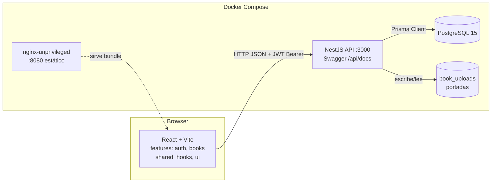
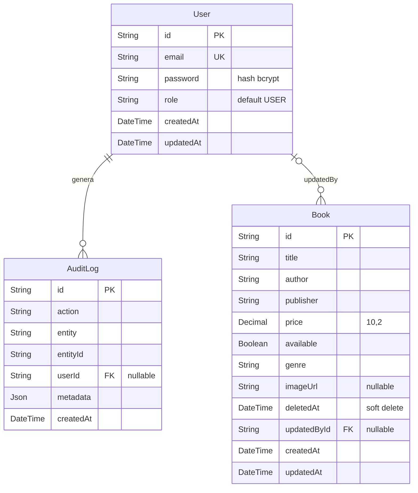

# cmcp-libros

CMPC Libros — Sistema de inventario Full Stack (NestJS + React + PostgreSQL). CRUD de libros con JWT, soft delete, filtros avanzados, paginación server-side, búsqueda con debounce, exportación CSV, auditoría y Swagger. Arquitectura modular por features, Prisma ORM, tests ≥80%, Docker Compose y README con diagramas.

## Descripción del proyecto

CMPC Libros es una aplicación de inventario de libros con autenticación JWT. Permite iniciar sesión, listar libros con filtros y paginación del lado del servidor, crear y editar libros con portada, exportar el listado filtrado a CSV y eliminar libros de forma lógica (soft delete). Cada escritura queda registrada en una tabla de auditoría.

El proyecto es un monorepo de npm workspaces con dos aplicaciones independientes que se comunican por HTTP JSON:

| Parte | Tecnología | Carpeta | Responsabilidad |
|---|---|---|---|
| API | NestJS 12, Prisma 6, PostgreSQL 15, Passport JWT | `backend/` | Autenticación, reglas de negocio, persistencia, CSV, portadas y Swagger |
| Web | React 19, Vite 8, React Router 7, Tailwind CSS 4, axios, react-hook-form, zod | `frontend/` | Interfaz de login, listado, filtros, formularios y exportación |
| Base de datos | PostgreSQL 15 | Compose (`cmcp-libros-db`) | Usuarios, libros y auditoría |

Índice: [Cumplimiento](#cumplimiento-de-la-prueba-técnica) · [Estructura](#estructura-del-monorepo) · [Instalación](#requisitos-previos) · [Configuración](#variables-de-entorno) · [Uso](#guía-de-uso) · [Arquitectura](#arquitectura) · [Modelo de datos](#modelo-de-datos) · [Decisiones](#decisiones-y-alternativas-descartadas) · [Pruebas](#pruebas-y-cobertura) · [Supuestos y limitaciones](#supuestos) · [Desarrollo local](#desarrollo-local-sin-docker)

## Cumplimiento de la prueba técnica

| Requisito | Dónde se resuelve |
|---|---|
| Login de autenticación (JWT) | [Guía de uso](#guía-de-uso), `POST /auth/login` |
| Listado con filtros (género, editorial, autor, disponibilidad), orden, paginación server-side y búsqueda con debounce | [Guía de uso](#guía-de-uso), `GET /books` |
| Alta y edición con validación reactiva y carga de portada | `frontend/src/features/books/book-form.schema.ts`, `POST /books/cover` |
| Visualización del detalle de un libro | `GET /books/:id` |
| Arquitectura modular con principios SOLID | [Backend](#backend-nestjs) |
| CRUD REST, exportación CSV, soft delete y auditoría | [Endpoints](#endpoints) |
| Prisma, modelo normalizado, índices y transacciones | [Modelo de datos](#modelo-de-datos) |
| Tests unitarios de frontend y backend, cobertura objetivo ≥ 80% | [Pruebas y cobertura](#pruebas-y-cobertura) |
| Manejo de errores en frontend y backend, interceptores | [Piezas transversales](#piezas-transversales-common), [Frontend](#frontend-react--vite) |
| `docker-compose.yml` para todo el stack | [Inicio rápido con Docker](#inicio-rápido-con-docker) |
| Documentación: instalación, uso, arquitectura, Swagger, diagramas | Este README y `/api/docs` |

## Estructura del monorepo

```text
cmcp-libros/
├── backend/                  API NestJS + Prisma (workspace)
│   ├── prisma/               schema.prisma, migraciones y seeds
│   ├── src/                  módulos auth, books, common, prisma
│   └── Dockerfile            imagen multi-etapa, usuario no root
├── frontend/                 SPA React + Vite (workspace)
│   ├── src/                  app, features, shared, lib, entities, styles
│   ├── nginx.conf            sirve el build estático en el puerto 8080
│   └── Dockerfile            build con Vite y servidor nginx
├── docker-compose.yml        db + api + web
├── .env.example              plantilla de variables (solo marcadores)
├── package.json              workspaces y scripts raíz
└── package-lock.json         lockfile único del monorepo
```

Scripts de la raíz (ejecutan el script equivalente en cada workspace):

| Comando | Qué hace |
|---|---|
| `npm ci` | Instala dependencias de backend y frontend con el lockfile raíz |
| `npm run build` | Genera el cliente de Prisma y compila backend (`prisma generate && nest build`) y frontend (`tsc -b && vite build`) |
| `npm run lint` | Ejecuta oxlint en ambos workspaces |
| `npm run test:backend` | Ejecuta las pruebas unitarias del backend |
| `npm run test:frontend` | Ejecuta las pruebas unitarias del frontend |

Para ejecutar un script de un solo workspace usa `npm run <script> --workspace backend` o `--workspace frontend`.

## Requisitos previos

- Docker y Docker Compose v2 (para ejecución con contenedores).
- Para desarrollo local: Node.js 24+ y npm 12+ (el `package.json` raíz usa `allowScripts`), y PostgreSQL 15 o el servicio `cmcp-libros-db` de Compose.

## Inicio rápido con Docker

```bash
cp .env.example .env
# Edita .env: define POSTGRES_PASSWORD, JWT_SECRET y SEED_ADMIN_PASSWORD con valores propios
docker compose up --build
```

| Servicio | URL por defecto |
|---|---|
| Frontend | http://localhost:8080 |
| API | http://localhost:3000 |
| Swagger | http://localhost:3000/api/docs |
| PostgreSQL (host) | localhost:5433 |

El backend ejecuta `npx prisma migrate deploy && node dist/main` al arrancar. El servicio `db` tiene un healthcheck (`pg_isready`) y la API no inicia hasta que esté saludable.

Para cargar datos de prueba en la base publicada por Compose (con `DATABASE_URL` apuntando a `localhost:5433`), ejecuta los seeds desde `backend/` cargando `../.env`. Los scripts `prisma:seed` y `prisma:seed:books` no leen `.env` por sí solos:

```bash
cd backend
node --env-file-if-exists=../.env --import tsx prisma/seed.ts        # administrador (requiere SEED_ADMIN_PASSWORD)
node --env-file-if-exists=../.env --import tsx prisma/seed-books.ts  # 32 libros de demostración (idempotente)
```

## Variables de entorno

Los valores de `.env.example` son marcadores; no contienen secretos. Nunca subas `.env` al repositorio.

| Variable | Obligatoria | Por defecto | Descripción |
|---|---|---|---|
| `POSTGRES_DB` | No | `cmcp_libros` | Nombre de la base de datos |
| `POSTGRES_USER` | No | `cmcp_libros` | Usuario de PostgreSQL |
| `POSTGRES_PASSWORD` | Sí | — | Contraseña de PostgreSQL |
| `POSTGRES_PORT` | No | `5433` | Puerto publicado de PostgreSQL en el host |
| `DATABASE_URL` | Sí (fuera de Compose) | — | Cadena de conexión de Prisma |
| `JWT_SECRET` | Sí | — | Clave para firmar los JWT; la API no inicia sin ella |
| `JWT_EXPIRATION` | No | `15m` | Expiración del token |
| `CORS_ORIGIN` | No | `http://localhost:5173` | Origen permitido por CORS (Compose lo fija al frontend) |
| `SEED_ADMIN_PASSWORD` | Solo para el seed | — | Contraseña del administrador inicial; el seed falla si falta |
| `API_PORT` | No | `3000` | Puerto publicado de la API |
| `WEB_PORT` | No | `8080` | Puerto publicado del frontend |

En Compose, `VITE_API_URL` se pasa como argumento de build del frontend (`http://localhost:${API_PORT}`), porque Vite lo incrusta en el bundle durante la compilación.

## Guía de uso

1. **Login**: abre el frontend e inicia sesión con el administrador creado por el seed (`admin@cmcp.cl` y `SEED_ADMIN_PASSWORD`). Un 401 en cualquier llamada cierra la sesión y redirige a `/login`.
2. **Listado**: la tabla muestra los libros activos con paginación del lado del servidor.
3. **Filtros**: búsqueda por texto, autor, editorial, género y disponibilidad, con orden por un campo y paginación. La búsqueda de texto espera a que dejes de escribir (debounce) antes de consultar la API y los filtros se reflejan en la URL. "Limpiar filtros" restablece todos los campos.
4. **Crear y editar**: el formulario valida en cliente y el backend revalida con `ValidationPipe` (`whitelist`, `forbidNonWhitelisted`). Las portadas se suben antes de guardar el libro.
5. **Exportar CSV**: `GET /books/export/csv` devuelve los libros que cumplen los filtros activos.
6. **Eliminar**: el borrado es lógico (`deletedAt`). Los libros eliminados dejan de aparecer en las consultas, pero permanecen en la base de datos. No hay endpoint de restauración todavía.

Swagger en `/api/docs`: pulsa **Authorize**, pega el `accessToken` devuelto por `POST /auth/login` y usa "Try it out" en los endpoints de libros.

## Arquitectura



### Backend (NestJS)

- **Módulos por feature**: `auth` (login, JWT con Passport) y `books` (controlador, servicio, repositorio, DTOs y carga de portadas). `common` contiene interceptores y filtros transversales. `prisma` expone el cliente.
- **Capas**: controlador (HTTP y validación) → servicio (reglas de negocio) → repositorio (acceso a datos). El repositorio existe solo para `books`, porque es la única entidad con lógica de consulta compleja (filtros, paginación, soft delete y exportación). `auth` usa Prisma directamente.
- **Soft delete**: `deletedAt` en lugar de `DELETE` físico. Conserva trazabilidad y permite añadir restauración sin pérdida de datos; las consultas filtran `deletedAt IS NULL`.
- **Paginación server-side**: `page` y `limit` se validan en el DTO y la consulta usa `skip/take` con conteo total, para no cargar toda la tabla en el navegador.
- **Auditoría**: `LoggingInterceptor` registra en JSON las mutaciones (POST, PATCH, DELETE) con acción, entidad, identificador y usuario, sin tokens ni cuerpos de petición.

#### Endpoints

| Método | Ruta | Acceso | Descripción |
|---|---|---|---|
| `POST` | `/auth/login` | Público | Devuelve `accessToken` y datos del usuario |
| `GET` | `/books` | JWT | Listado paginado y filtrado (`search`, `genre`, `publisher`, `author`, `available`, `sortBy`, `order`, `page`, `limit` máx. 100) |
| `GET` | `/books/export/csv` | JWT | CSV con los libros que cumplen los mismos filtros |
| `GET` | `/books/:id` | JWT | Detalle de un libro activo |
| `POST` | `/books` | JWT | Crea un libro |
| `PATCH` | `/books/:id` | JWT | Actualiza campos de un libro |
| `DELETE` | `/books/:id` | JWT | Soft delete (marca `deletedAt`) |
| `POST` | `/books/cover` | JWT | Sube una portada (campo `file`, PNG o JPEG, máx. 5 MB, validado por firma de bytes) |

Swagger documenta todos los endpoints y sus DTOs en `/api/docs` (por ejemplo, `http://localhost:3000/api/docs`). La especificación JSON generada está disponible en `/api/docs-json`.

#### Arranque y configuración

- `main.ts` registra un `ValidationPipe` global (`whitelist`, `forbidNonWhitelisted`, `transform`), CORS configurable con `CORS_ORIGIN`, Swagger montado en `/api/docs` con esquema de autenticación Bearer (`addBearerAuth`), y la carpeta `uploads/` servida como estática en `/uploads`.
- El puerto es `PORT` o 3000 por defecto.
- `start` y `start:dev` cargan `../.env` con `--env-file-if-exists`. `start:prod` ejecuta `node dist/main` y espera las variables ya definidas en el entorno (como en el contenedor).
- Las migraciones se aplican con `prisma migrate deploy`, nunca con `migrate dev`, en contenedores y producción.

#### Piezas transversales (`common/`)

- `HttpExceptionFilter`: formato uniforme de errores HTTP.
- `TransformInterceptor`: envuelve las respuestas exitosas en `statusCode`, `data` y `timestamp`.
- `LoggingInterceptor`: registra en JSON cada POST, PATCH y DELETE (acción, entidad, identificador y usuario). No registra cuerpos de petición ni tokens.
- `@CurrentUser()`: expone el usuario autenticado al controlador.

### Frontend (React + Vite)

- **Estructura**: `app/` (rutas y `ProtectedRoute`), `features/` (`auth` y `books`), `shared/` (hooks y componentes de UI sin lógica de negocio), `lib/` (cliente HTTP y almacenamiento del token), `entities/` (tipos del dominio en el cliente) y `styles/` (punto de entrada de Tailwind CSS v4 con `theme.css`, `base.css` y `components.css`).
- **Estilos**: Tailwind CSS v4 se integra con el plugin `@tailwindcss/vite`. Los estilos compartidos viven en `src/styles/`, y los de la feature `books` en `books.styles.ts`. No hay archivos CSS por componente.
- **Rutas**: `/login`, `/books`, `/books/new`, `/books/:id`, `/books/:id/edit`. `ProtectedRoute` redirige a `/login` si no hay sesión.
- **Auth**: `AuthProvider` expone `user`, `isAuthenticated`, `login` y `logout` mediante contexto. El token se guarda en `sessionStorage` y en memoria.
- **Books**: `books.api.ts` concentra las llamadas (incluida la descarga del CSV); `books.filters.ts` convierte los filtros a query string y viceversa; `book-form.schema.ts` valida el formulario con zod; `hooks/useBooks.ts` mantiene el listado sincronizado con la URL.
- **Filtros**: los campos de texto usan `useDebounce` (300 ms) antes de confirmar el cambio en la URL, así que escribir no dispara una petición por tecla. "Limpiar filtros" restablece todos los campos.
- **Shared**: `shared/hooks` (`useDebounce`) y `shared/ui` (`Button`, `Input`, `Spinner`, `Toast`). Los componentes de `shared/ui` son presentacionales.
- **HTTP**: `lib/http.ts` crea una instancia de axios con `baseURL = VITE_API_URL || http://localhost:3000`, añade el encabezado `Authorization: Bearer`, cierra la sesión ante 401 (salvo en el propio login) y muestra avisos ante 403 y 5xx.
- **Pruebas**: Vitest con jsdom y Testing Library. Cubren login, listado, filtros, formularios, estados de carga, vacío, error y abortos.

### Modelo de datos



## Decisiones y alternativas descartadas

- **Sin Clean Architecture**: el dominio es CRUD con reglas simples. Módulos por feature con capas ligeras bastan y reducen el número de archivos por cambio.
- **Sin Drizzle**: Prisma ofrece migraciones versionadas, tipos generados y el seed integrado en el flujo de NestJS. Drizzle se descartó para no mantener dos capas de acceso a datos.
- **Repositorio solo para libros**: se aplica donde hay consultas complejas; añadirlo a todo sería sobreingeniería.
- **Debounce en la búsqueda**: evita una petición por cada tecla y mantiene la URL sincronizada con los filtros.

## Pruebas y cobertura

```bash
npm run test --workspace backend        # pruebas unitarias del backend
npm run test:cov --workspace backend    # backend con cobertura
npm run test:e2e --workspace backend    # pruebas end-to-end de la API
npm run test:cov --workspace frontend   # frontend con cobertura (Vitest + v8)
npm run lint                            # oxlint en todos los workspaces
```

Objetivo: al menos 80% de cobertura en líneas, sentencias, ramas y funciones, tanto en backend como en frontend. Los informes se generan en `backend/coverage/` y `frontend/coverage/` con `npm run test:cov`; las cifras exactas se verifican ahí, no se fijan en este documento.

Desde la raíz también puedes ejecutar `npm run test:backend` y `npm run test:frontend`.

## Limitaciones conocidas

- **Portadas en disco local**: se guardan en `uploads/` dentro del contenedor, con el volumen `book_uploads`. En producción se migraría a almacenamiento de objetos (S3 o equivalente) con URLs firmadas.
- **Sin refresh tokens**: el access token expira según `JWT_EXPIRATION`. Se implementaría un par access/refresh con rotación y revocación en base de datos.
- **Sin RBAC**: el campo `role` existe, pero los endpoints solo exigen autenticación. Se implementaría con un decorador `@Roles()` y un guard que compare el rol del usuario.
- **Sin rate limiting en login**: se añadiría `@nestjs/throttler` en el endpoint de autenticación.
- **Ordenamiento por un solo campo**: la API acepta `sortBy` y `order`, pero no ordena por varios campos a la vez. Se implementaría con un parámetro `sort=campo:asc,campo2:desc` que se traduzca a un `orderBy` de Prisma con varios elementos.
- **Índices parciales en filtros**: existen índices en `title`, `author`, `genre` y `deletedAt`. Los filtros por `publisher` y `available` no tienen índice todavía; se añadirían con `@@index` según el volumen de datos y las consultas más frecuentes.

## Desarrollo local sin Docker

Requiere PostgreSQL. La forma más simple es levantar solo la base de datos de Compose con `docker compose up -d cmcp-libros-db` y definir en `.env` una `DATABASE_URL` como esta (ajusta usuario, contraseña y nombre a los de tu `.env`):

```text
DATABASE_URL=postgresql://cmcp_libros:<POSTGRES_PASSWORD>@localhost:5433/cmcp_libros?schema=public
```

```bash
npm ci                                  # instala todos los workspaces desde la raíz
cp .env.example .env                    # completa DATABASE_URL, JWT_SECRET, SEED_ADMIN_PASSWORD
cd backend
node --env-file-if-exists=../.env node_modules/prisma/build/index.js migrate deploy
node --env-file-if-exists=../.env --import tsx prisma/seed.ts
node --env-file-if-exists=../.env --import tsx prisma/seed-books.ts
npm run start:dev                       # API en http://localhost:3000 (carga ../.env)
```

En otra terminal, desde la raíz:

```bash
npm run dev --workspace frontend        # Vite en http://localhost:5173
```

Sin `VITE_API_URL`, el frontend apunta a `http://localhost:3000`, y `CORS_ORIGIN` admite `http://localhost:5173` por defecto, así que no hace falta configurar nada más.

## Supuestos

- **Credenciales iniciales**: el email del administrador es `SEED_ADMIN_EMAIL` (por defecto `admin@cmcp.cl`) y la contraseña es el valor de `SEED_ADMIN_PASSWORD` en `.env`. No hay contraseña por defecto; el seed falla si la variable falta.
- **Secretos**: la API requiere `JWT_SECRET` y no inicia sin él. `JWT_EXPIRATION` usa `15m` si no se define.
- **Moneda e idioma**: el precio se guarda como `Decimal(10,2)` sin moneda explícita, asumiendo una sola moneda. La interfaz y la documentación están en español.
- **Roles**: se asume un único administrador operativo; el campo `role` existe para futuras reglas de acceso.
- **Token en el navegador**: se guarda en `sessionStorage` por simplicidad. En producción conviene valorar cookies `HttpOnly` para mitigar el robo de token por XSS.
